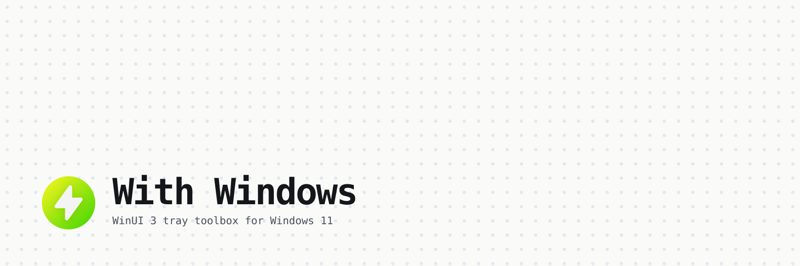
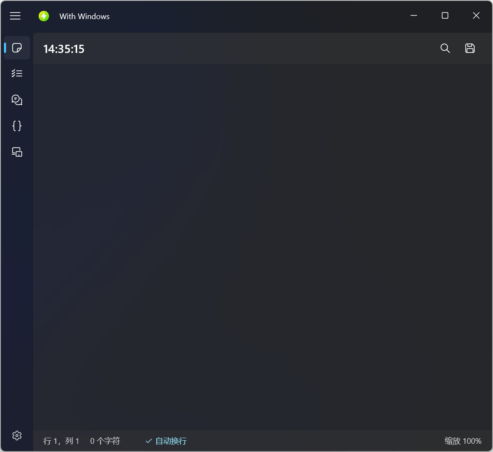
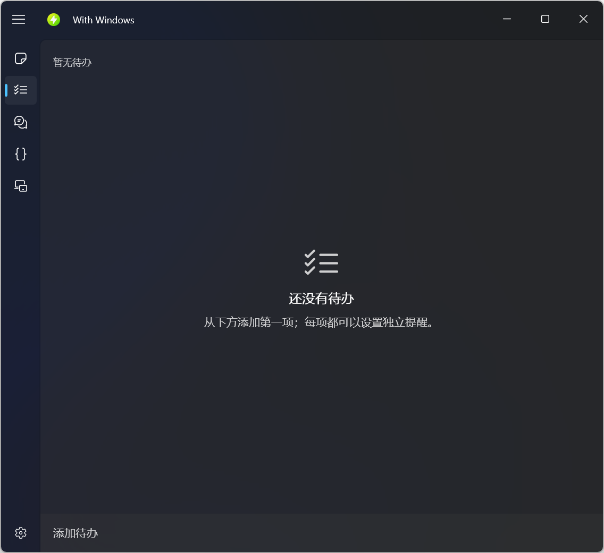
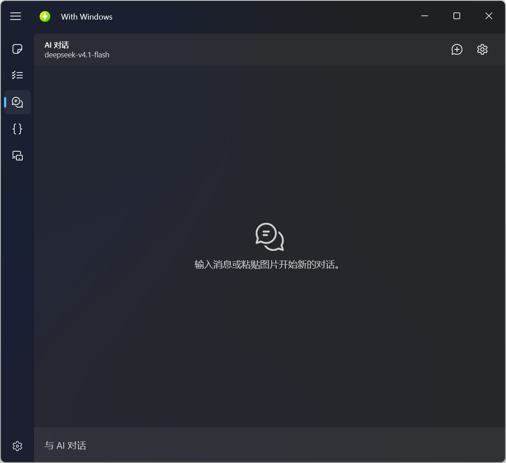
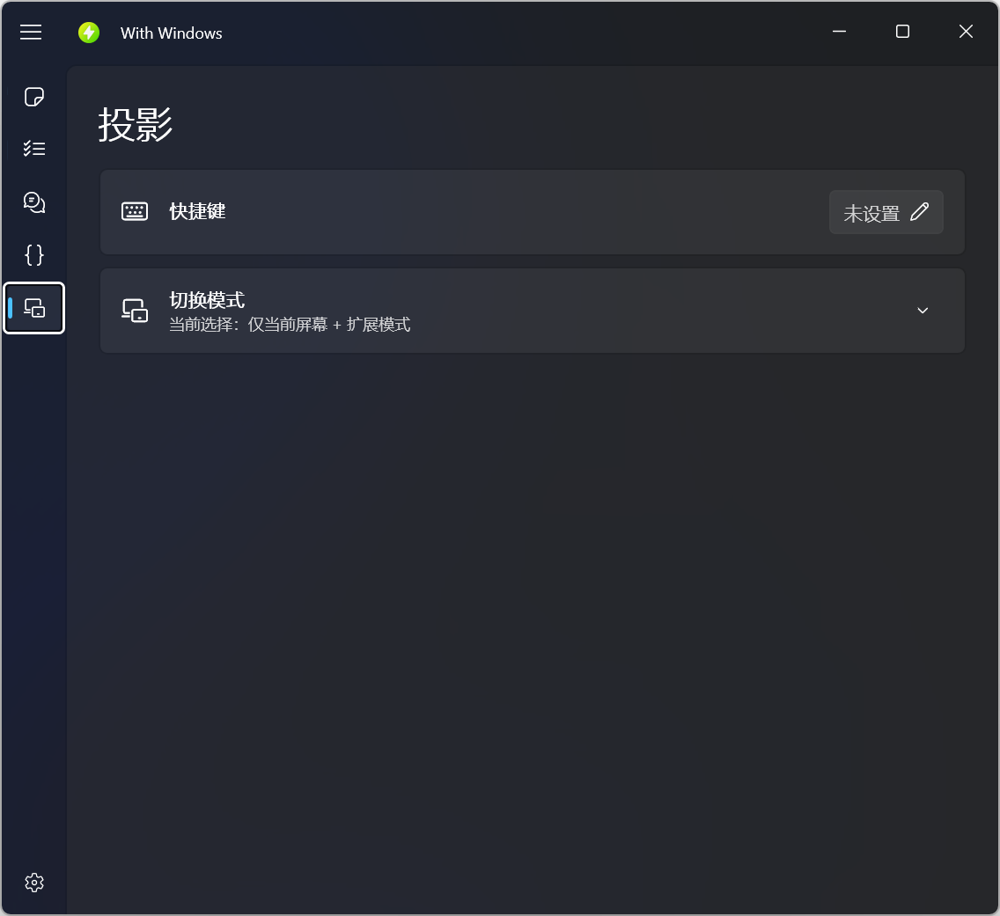

<picture>
  <source media="(prefers-color-scheme: dark)" srcset="assets/banner-dark.svg">
  
</picture>

# With Windows

面向 Windows 11 的 WinUI 3 轻量托盘工具箱，支持 Windows 11 22H2 及以上版本，仅提供 x64 安装器与便携包。

  
  

> 本项目由 AI 协作完成：代码、文档与迭代均经 AI 生成和优化。

## 功能

- **记事**：自动保存、查找替换和状态栏。
- **待办**：完成状态、到期时间与 Windows 原生提醒。
- **AI 对话**：兼容 OpenAI 接口，支持流式回复和图片粘贴。
- **Lua 脚本**：维护一组内置脚本，提供带基础语法高亮和行号的编辑器，支持手动、单次、每天、每周和每月执行，并提供停止、超时、带时间戳的合并运行日志。
- **投影**：保存投屏模式并一键切换。

应用内置 Lua 5.4，无需安装 Lua。Lua 脚本可以通过 `os.execute` 或 `io.popen` 调用本机已安装的 Python、Node.js 文件及其运行时，但这些运行时不会随应用安装。关闭主窗口后应用继续驻留托盘并执行定时计划；从托盘退出应用后不再运行脚本。Lua 及它启动的子进程均以当前用户权限执行，不是沙箱。

## 截图

<table>
  <tr>
    <td width="50%"></td>
    <td width="50%"></td>
  </tr>
  <tr>
    <td width="50%"></td>
    <td width="50%"></td>
  </tr>
</table>

## 许可证

本项目使用 [MIT 许可证](LICENSE)，第三方组件声明见 [THIRD_PARTY_NOTICES.txt](src/WithWindows.App/Assets/THIRD_PARTY_NOTICES.txt)。
