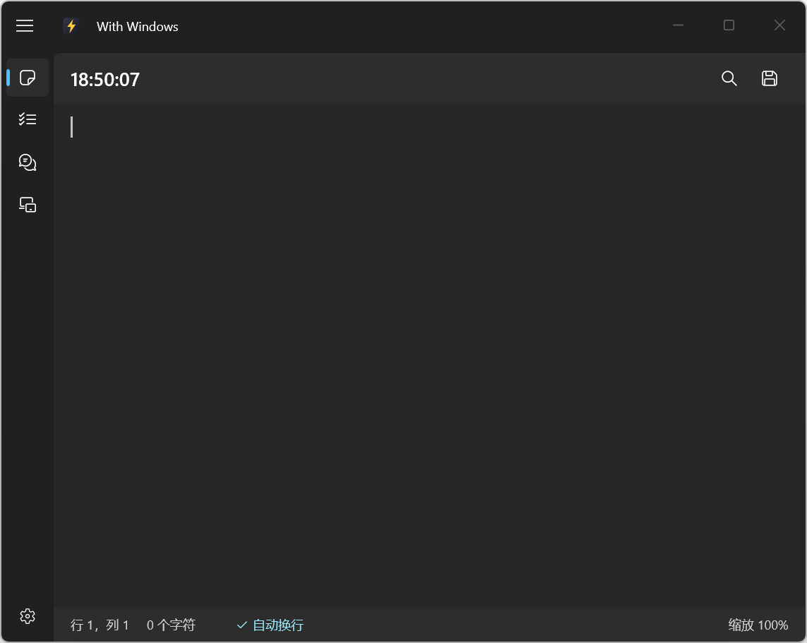
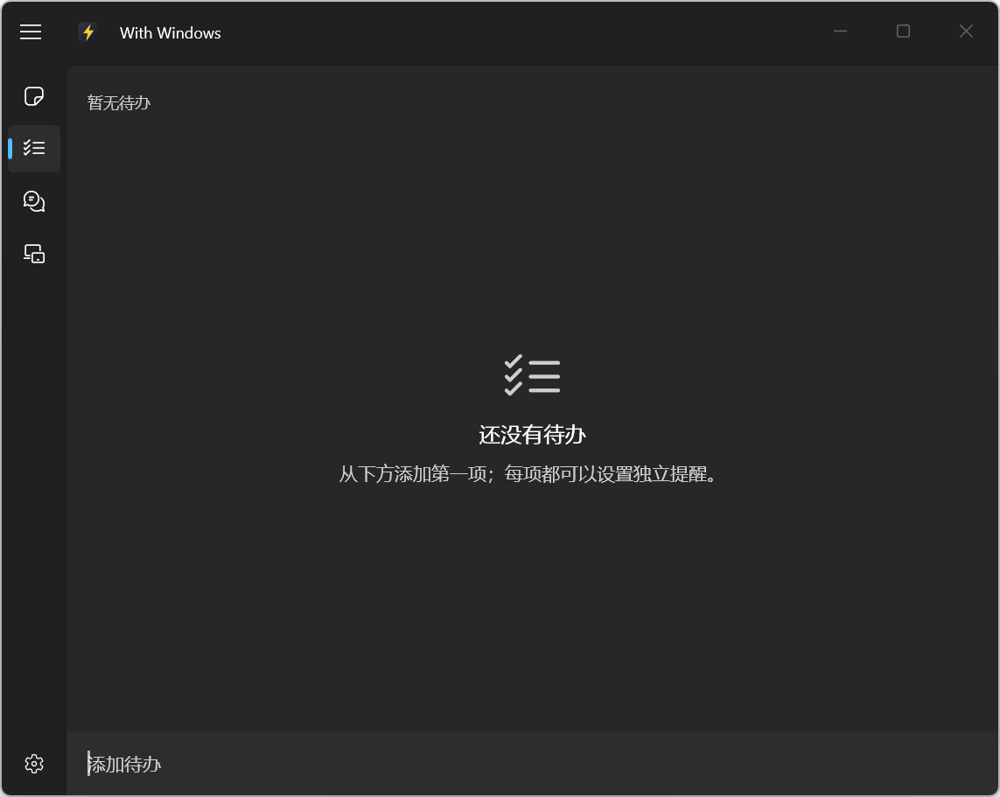
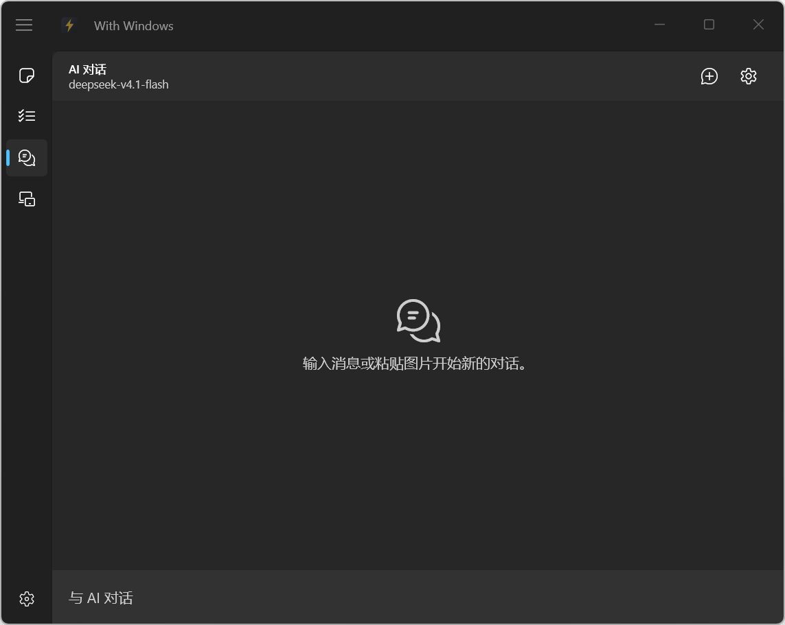
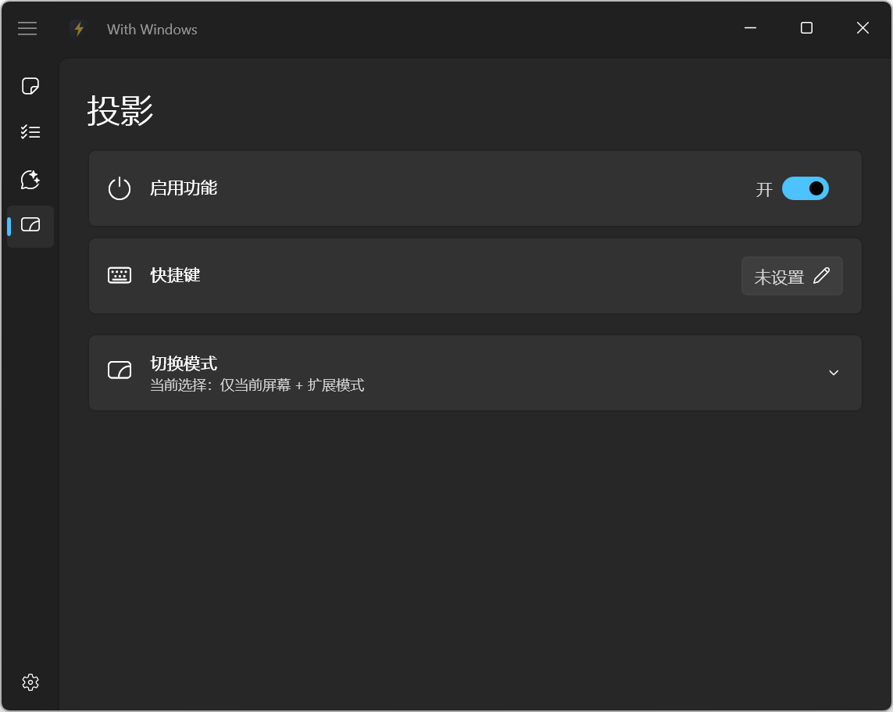

#  With Windows

> 本项目由 AI 协作完成：代码、文档与迭代均经 AI 生成和优化。

Windows 11 的轻量托盘工具箱，使用 WinUI 3 构建。关闭窗口后继续驻留托盘，支持 Windows 11 22H2 及以上版本，仅提供 x64 安装器与便携包。

## 功能

- **记事**：自动保存的纯文本编辑器，带查找替换和状态栏。
- **待办**：添加、完成、删除待办，并支持单项到期提醒；应用窗口打开时通过 Windows 原生通知提醒，最小化期间到期的项目会在下次恢复窗口时显示，应用完全退出后不会触发提醒。
- **AI 对话**：连接 OpenAI 兼容接口，支持流式回复和图片粘贴。
- **投影**：保存投屏模式并一键切换。

<table>
  <tr>
    <td width="50%"></td>
    <td width="50%"></td>
  </tr>
  <tr>
    <td width="50%"></td>
    <td width="50%"></td>
  </tr>
</table>

## 下载

当前版本为 `v0.8.0`。前往 [GitHub Release](https://github.com/Lifeni/with-windows/releases/latest) 下载。

[查看更新日志](CHANGELOG.md)

## 开源协议

本项目使用 [MIT 协议](LICENSE)。
