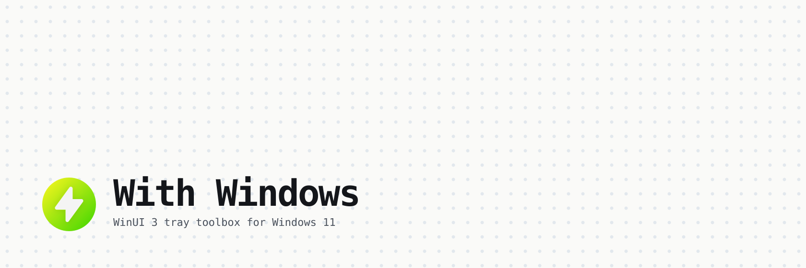
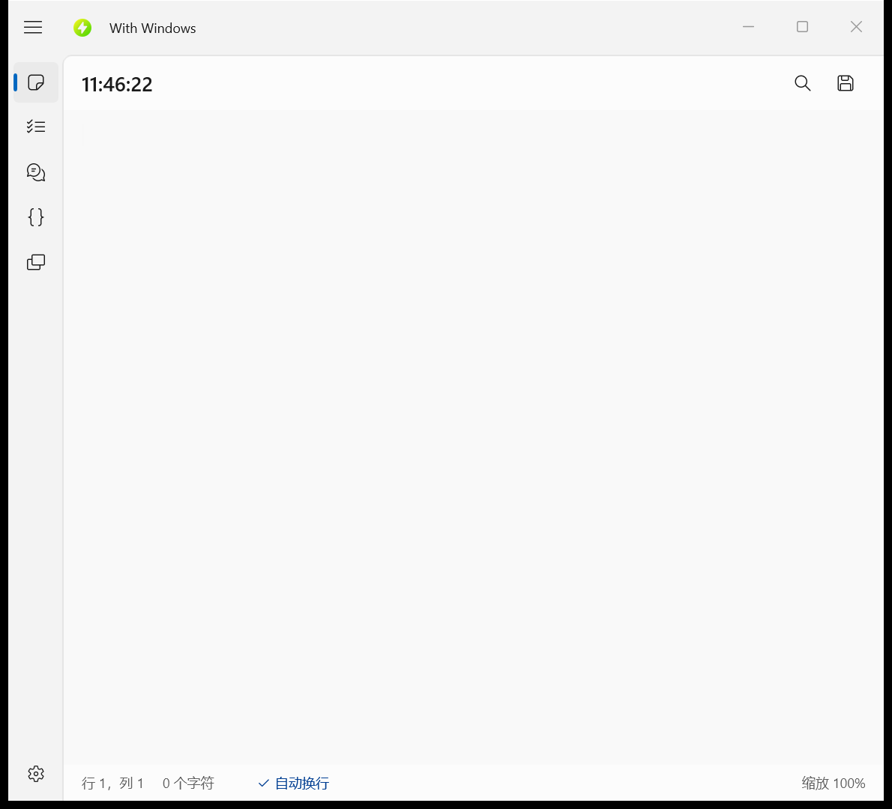
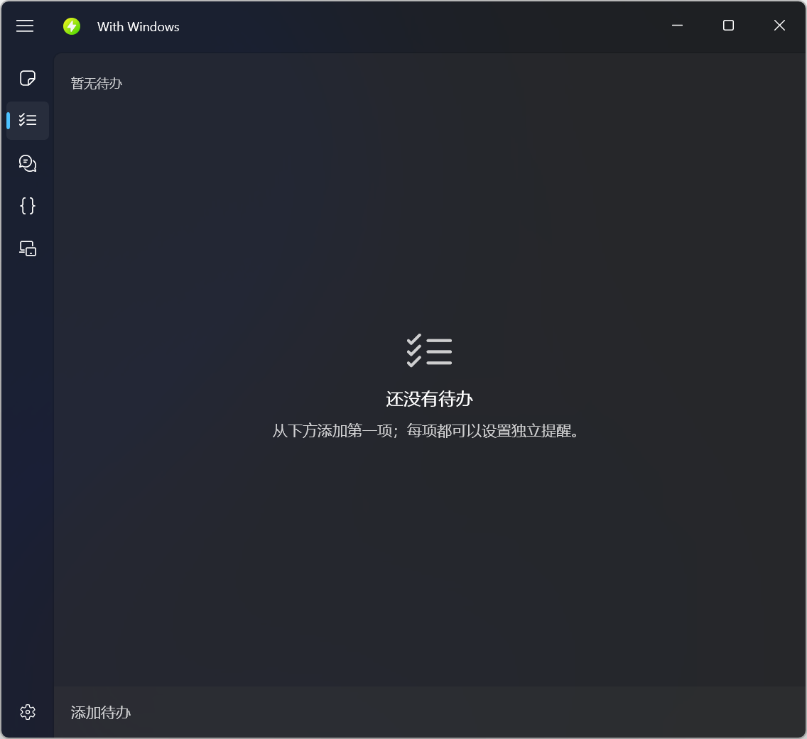
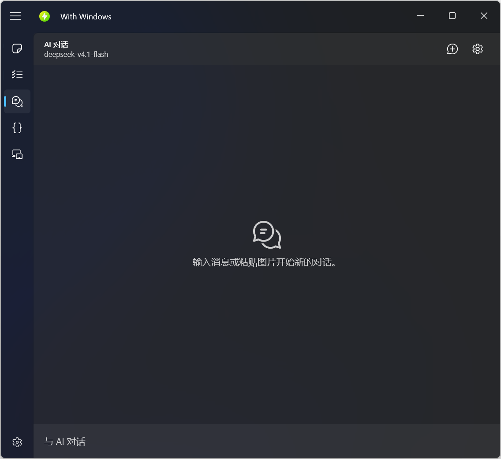
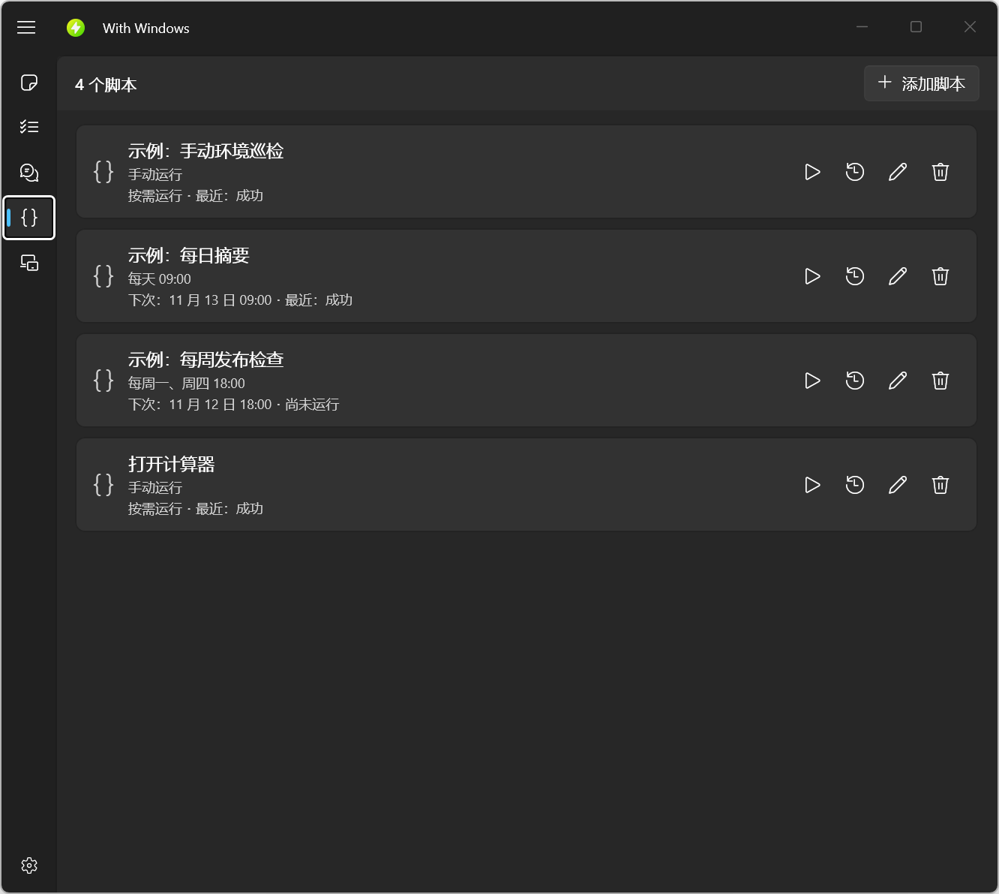
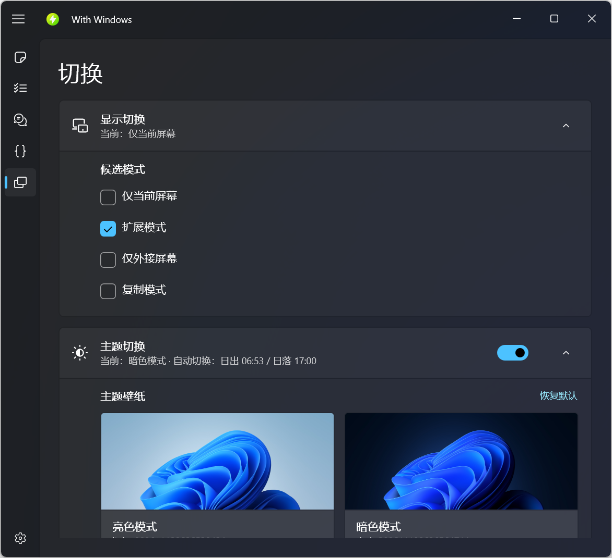
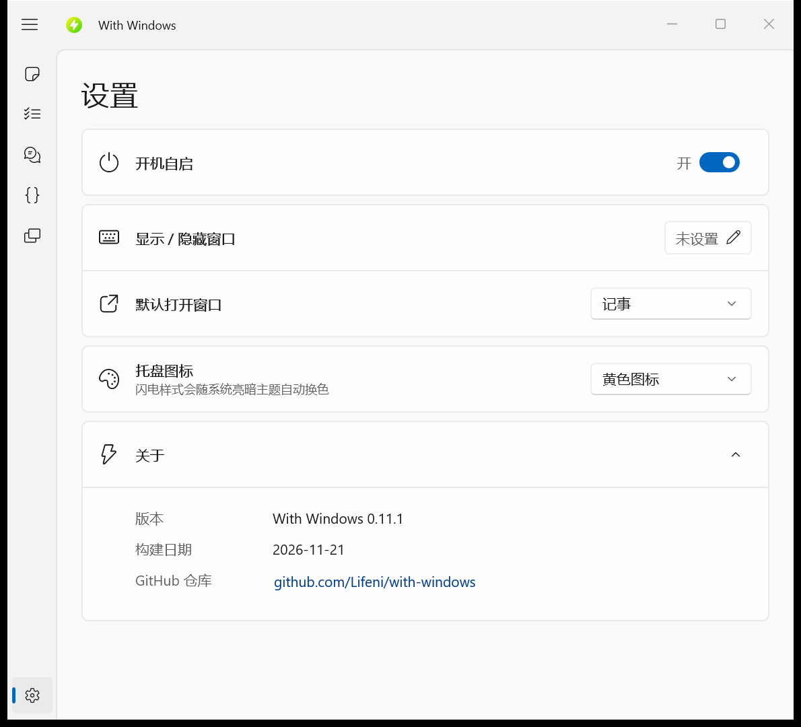

<picture>
  <source media="(prefers-color-scheme: dark)" srcset="assets/banner-dark.svg">
  
</picture>

# With Windows

面向 Windows 11 的 WinUI 3 轻量托盘工具箱，支持 Windows 11 22H2 及以上版本，仅提供 x64 安装器与便携包。

  
  

> 本项目由 AI 协作完成：代码、文档与迭代均经 AI 生成和优化。

## 功能

- **记事**：自动保存、查找替换和状态栏。
- **待办**：完成状态、到期时间与 Windows 原生提醒；首次执行示例初始化时，若无待办数据则附带示例待办。
- **AI 对话**：兼容 OpenAI 接口，支持流式对话、图片粘贴和脚本生成。
- **脚本**：使用 C# 编写脚本，支持手动或定时执行、语法高亮和运行日志；首次执行示例初始化时，若无脚本数据则附带示例脚本。
- **切换**：一键循环切换显示模式与 Windows 亮暗主题；显示模式候选至少选择两项，恰好两项时锁定已选项，再勾选一项后即可调整；主题可按当前位置的日出日落自动切换，并分别设置亮色与暗色壁纸；定位不可用时按默认的 `07:00` / `19:00` 切换。
- **设置**：开机自启、显示 / 隐藏窗口快捷键、默认打开页面与托盘图标样式；默认使用细线闪电图标，并随亮暗主题自动换色。

## 截图

截图同时展示浅色与深色主题，各三张。

<table>
  <tr>
    <td width="50%"></td>
    <td width="50%"></td>
  </tr>
  <tr>
    <td width="50%"></td>
    <td width="50%"></td>
  </tr>
  <tr>
    <td width="50%"></td>
    <td width="50%"></td>
  </tr>
</table>

## 许可证

本项目使用 [MIT 许可证](LICENSE)，第三方组件声明见 [THIRD_PARTY_NOTICES.txt](src/WithWindows.App/Assets/THIRD_PARTY_NOTICES.txt)。
